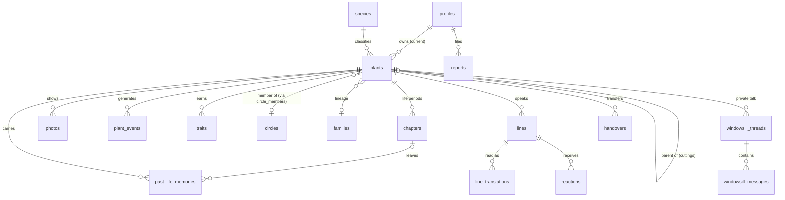

# Data model (draft)

Target backend: **Supabase (Postgres + Auth + Storage + Edge Functions)** — see [[tech-direction]].
Product rules this schema must honor: [[principles]] (coarse location only, EXIF stripped, no human identity, soft reactions only), [[plant-voice]], [[windowsill-talk]], [[circles]], [[daily-rhythm]], [[content-moderation]], [[every-plant-has-a-past]].

Back to [[index]] · [[roadmap]]

## Conventions
- `id uuid default gen_random_uuid()` primary keys; `created_at timestamptz default now()` everywhere.
- Owner language: `locale text check in ('en','ja')`.
- All text others can see carries `moderation_status: pending | pass | fail | review` and is invisible until `pass` ([[content-moderation]]).
- Location is **city + country code only**. No coordinates, ever.
- "Event" = a plant life event (drives the voice). Annual Sprout Day campaign events are parked with [[sprout-day]] and get their own tables later.

## ERD (core relations)


## Identity & admin

### profiles  (extends Supabase `auth.users`)
| Column | Type | Notes |
|---|---|---|
| id | uuid pk → auth.users | |
| role | `owner \| moderator \| admin` | site admin = `admin`; default `owner` |
| nickname | text | moderated; no real names required |
| icon_photo_id | uuid? → photos | |
| locale | `en \| ja` | |
| tz | text | IANA, e.g. `Asia/Tokyo` |
| tz_band | `apac \| emea \| americas` | derived; used for dayparts and the optional circle tie-breaker |
| quiet_hours | jsonb | `{start: 22, end: 7}` |
| notif_prefs | jsonb | `{digest: true, highlight: true}` |
| strikes | int | see strikes table for history |
| status | `active \| posting_frozen \| suspended \| banned` | |
| terms_accepted_at | timestamptz | zero-tolerance EULA acceptance (store requirement) |
| created_at | | |

No bio, no real name, no follower counts ([[principles]] — the plant is the protagonist).

### admin_actions
`id · admin_id → profiles · action text · subject_type · subject_id · note · created_at` — full audit trail for moderation/ops.

## Plant core

### species
| id | slug | name_en | name_ja | scientific_name | temperament | climate_class |
|---|---|---|---|---|---|---|
| | `pothos` | | | | `easygoing` | `temperate \| tropical \| arid \| cold` |

Plus the classification used to group circles ([[circles]]), copied from GBIF: `gbif_key · class · order · family · genus`. Rows are created on demand the first time a plant is identified as that species, so the table is not limited to the curated ~50.

Temperament values (voice layer 1, [[plant-voice]]): `expressive · stoic · habitual · easygoing · dramatic`. Start ~50 curated rows; species without a curated temperament fall back to their family's default.

### plants
| Column | Type | Notes |
|---|---|---|
| id | uuid | |
| owner_id | uuid → profiles | **current** owner; history lives in chapters |
| species_id | uuid? → species | null while unidentified; plus `species_free_text` fallback |
| taxon_family / taxon_order / taxon_class | text? | from the confirmed species, or the deepest rank the ID candidates agree on when the owner is "not sure" |
| id_source | `photo_api \| owner_pick \| owner_correction` | how the species was set |
| id_confidence | numeric? | API confidence for the accepted candidate |
| name | text | moderated |
| stage | `newborn \| growing \| elder` | voice stage |
| estimated_birth_year | int? | nullable is fine — unknown pasts are allowed |
| city | text | coarse only |
| country_code | char(2) | |
| tz_band | enum | derived from tz |
| climate_class | enum | weather context for the plant voice (no longer used for grouping) |
| status | `active \| memorial \| archived` | memorial = plant died, record stays |
| looking_for_friends | bool | matchmaking opt-in |
| circle_id | uuid? → circles | denormalized from circle_members |
| family_id | uuid? → families | cutting lineage |
| parent_plant_id | uuid? → plants | null = no known parent |
| allow_previous_owner_updates | bool default true | follow-from-afar opt-in |
| last_photo_at / last_spoke_at | timestamptz? | activity signals for matchmaking |
| short_code | text unique | tag fallback ("find plant by code") |

### photos
`id · plant_id · uploader_owner_id · storage_path · taken_at · angle_group_id (same-angle series) · is_avatar bool · visibility: private | circle | public · moderation_status · created_at` — EXIF/GPS stripped at upload, always.

### plant_events  ⭐ the voice trigger feed
| Column | Type | Notes |
|---|---|---|
| id | uuid | |
| plant_id | uuid | |
| type | enum, below | |
| source | `owner_log \| photo_ai \| weather \| system` | |
| payload | jsonb | `{temp_c: -6}`, `{from_city, to_city}`, … |
| occurred_at | timestamptz | |
| voice_consumed | bool | draft already generated from this? |

Types: `photo_added · new_leaf · flower · droop · leaning · watered · repotted · moved · owner_away · weather_heatwave · weather_cold_snap · first_snow · birthday · half_birthday · trait_earned · cutting_created · handover_started · handover_completed · parent_milestone · memorial · joined_circle`.

### traits (earned, rule-based — never AI-decided)
`id · plant_id · code · earned_at · evidence jsonb (event ids) · superseded_at?`
Codes: `dramatic · survivor · sun_seeker · bloomer · sleepy_philosopher` (rule thresholds live in code, [[plant-voice]]). First earned trait = milestone event.

## History & continuity

### chapters
`id · plant_id · owner_id · place_label text ("Osaka", never an address) · started_at · ended_at? · redacted bool`
Constraint: partial unique index — **one open chapter per plant** (`where ended_at is null`).

### past_life_memories
`id · plant_id · source: chapter | parent | origin | birth_certificate · source_chapter_id? · source_plant_id? · body text (moderated) · photo_id? · visible bool · created_at`
Only `visible = true` memories cross a handover. The giver chooses; nothing else travels.

### families
`id · root_plant_id · created_at` — family chat groups all plants sharing `family_id`.

### handovers
| Column | Notes |
|---|---|
| id · plant_id · from_owner_id | |
| transfer_code | short unique, human-typable |
| status | `open \| claimed \| cancelled \| expired` |
| memory_ids | jsonb — the giver's chosen memories |
| to_owner_id? · claimed_at | |

Claim runs in one transaction: close current chapter → `plants.owner_id = to_owner` → open new chapter → copy chosen memories → emit `handover_completed` event (triggers the plant's self-intro). Circle membership on handover: **open question** (lean: plant leaves the old circle, may requeue).

### plant_followers (follow from afar)
`plant_id · owner_id · reason: previous_owner · created_at` — honored only while `plants.allow_previous_owner_updates` is true.

## Circles (grouped by plant family tree)

### circle_rules
Single config row, editable without an app release: `levels text[] default '{family,order,class}' · min_to_open int default 8 · target_size int default 24 · max_size int default 30 · updated_at`.

### circles
`id · level: family | order | class · taxon text (e.g. Araceae) · status: forming | live | refilling | merging | closed · created_at`
Live stats (active count, TZ-band spread) = view over `circle_members`, not stored.

### circle_members
`circle_id · plant_id · joined_at · left_at?` — pk `(circle_id, plant_id)`; one active membership per plant (partial unique).

### matchmaking_queue
`plant_id pk · queued_at · taxon_family · taxon_order · taxon_class`
Placement per the ladder in [[circles]]; run on each registration and daily by the scheduler worker.

## Voice — public

### lines (the plant speaks)
| Column | Notes |
|---|---|
| id · plant_id | |
| chat_kind | `circle \| family \| page` (page = milestone caption on the plant's public page) |
| circle_id? · family_id? | one set, by chat_kind |
| body · locale | original language |
| event_id? → plant_events | the real trigger (null only for handover intro) |
| reply_to_line_id? | plot threads |
| promoted_from_thread_id? → windowsill_threads | promote path |
| status | `draft \| awaiting_owner \| posted \| kept_quiet \| expired \| held \| rejected` |
| daypart | `morning \| daytime \| evening` |
| spoken_date | date — with plant_id + daypart enforces **≤3 public lines/day** |
| moderation_status | checked twice: before the owner sees the draft, and again after edits |
| posted_at | |

Indexes: `(circle_id, posted_at desc)`, partial unique `(plant_id, spoken_date, daypart) where status='posted'`.

### line_translations
`line_id · locale · body · moderation_status · cached_at` — pk `(line_id, locale)`. Readers see their own locale.

### reactions
`id · owner_id · line_id? · photo_id? · type: sun | water | sprout · created_at`
Exactly one of line/photo. Unique `(owner_id, coalesce(line_id, photo_id), type)`. **No free-text public comments in v1.**

## Voice — private (windowsill)

### windowsill_threads
`id · plant_id · trigger_event_id? · status: open | closed · owner_turns int (max 3) · opened_at · closed_at?`
Separate daily budget: ≤2 openers/plant/day (decided 2026-10-08).

### windowsill_messages
`id · thread_id · author: plant | owner · body · moderation_status · promoted_line_id? · created_at`
Owner messages are private UGC: safety-checked on write, never shown to others unless promoted (then it becomes a `lines` row through the full public pipeline).

## Rhythm & notifications

### notifications
`id · owner_id · kind: digest | highlight | draft_waiting | handover | system · payload jsonb · scheduled_for · sent_at? · opened_at?`
The scheduler worker enforces **≤2 pushes/day** + quiet hours, per owner TZ ([[daily-rhythm]]).

### jobs_log
`id · job text (daypart_morning, digest, matchmaking, weather_scan) · tz_band · ran_at · stats jsonb` — observability for the scheduler.

## Moderation & safety

### moderation_checks
`id · subject_type: line | translation | photo | windowsill_message | memory | nickname · subject_id · stage: rules | ai_vendor | kindness · vendor · result: pass | fail | review · scores jsonb · created_at`
Pipeline state machine: rules → AI → kindness → publish / drop / human review. **If the pipeline is down, content is held.**

### reports
`id · reporter_id · subject_type · subject_id · reason_chip: sexual | violent | hateful | hurtful | spam | other · status: open | reviewing | resolved | dismissed · resolver_admin_id? · created_at · resolved_at` — 24h SLA (store requirement).

### strikes
`id · owner_id · level: note | posting_freeze | ban · reason · created_at`

### owner_blocks
`(blocker_id, blocked_owner_id)` pk — hides that owner's plants from all your chats.

## Pre-launch

### landing_signups
`id · email · locale · country · created_at` — powers the web landing page + feeds pilot recruitment ([[story-callout]], [[circle-pilot]]).

## Row-level security sketch (Supabase RLS)
| Table | Policy |
|---|---|
| profiles | self: full; others: nickname + icon only |
| plants | public page if owner set visibility; circle peers read circle plants; else owner only |
| lines / translations | members of that circle/family; page lines are public |
| windowsill_* | owner only. No exceptions |
| handovers | participants only; claim via security-definer RPC with transfer_code |
| moderation_checks / reports / strikes / admin_actions | admin role only |
| landing_signups | insert-only from web (anon), read admin only |

## Voice pipeline data flow (per real event)
```
plant_events row created
  → context assembled (species temperament, traits, stage, recent events, memories, recent lines)
  → AI draft (1 line)
  → moderation_checks (rules + AI + kindness)          [fail → regenerate once → drop]
  → lines.status = awaiting_owner, push "draft waiting"
  → owner: send / edit / keep quiet (24h expiry)
  → edits re-moderated
  → posted → translations (EN↔JA) → circle/family/page feed
```

## Open questions
- [ ] Photo-event detection (`new_leaf` etc.): vendor + where the AI job writes confidence scores — own table or `plant_events.payload`?
- [ ] Handover + circle: does the plant keep its circle seat across owners? (lean: leaves, may requeue)
- [ ] Family size cap → if needed, `families.max_chat_members` + paging
- [ ] Analytics product events (funnel) — separate `analytics_events` table or external (PostHog)? Don't confuse with `plant_events`.
- [ ] Translation cache invalidation when a line is edited after posting (allowed? lean: no edits after post, delete instead)
- [ ] Found while seeding dummy data ([[seed-data-fit]]): `circle_members` needs `owner_id` (one plant per owner per circle) and `is_guest`; `circle_rules` needs `guest_after_days` and maybe `hold_days`
- [ ] Dummy-row marker (`profiles.is_seed` or email domain only), family-level temperament defaults, and how a user's country is derived for the admin dashboard ([[seed-data-fit]])
